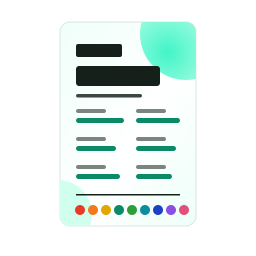
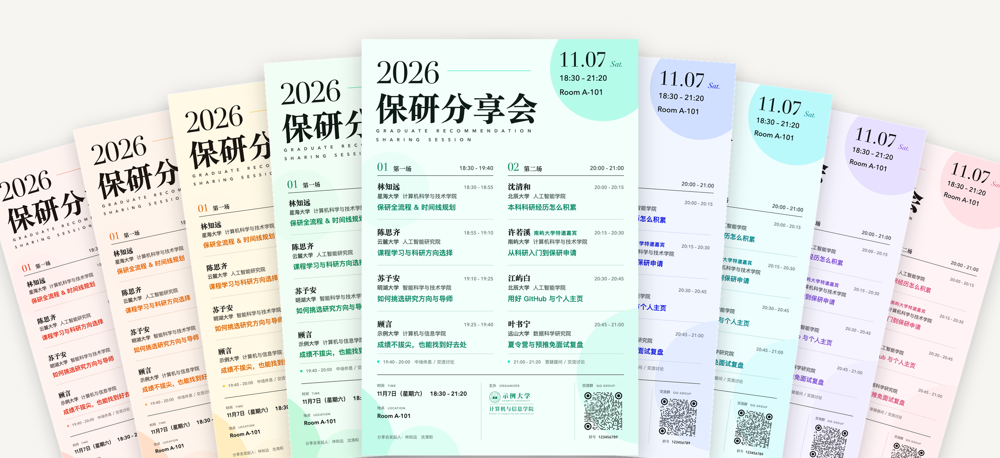
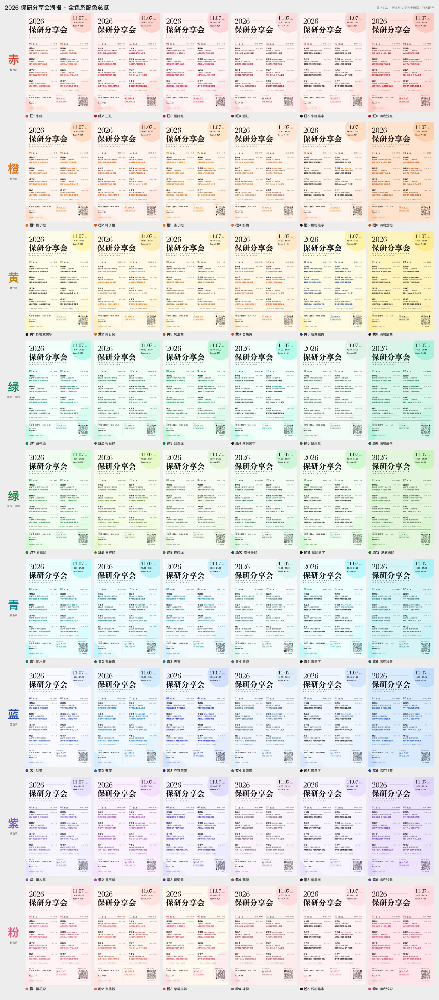

<div align="center">



# 保研分享会海报模板

**改一个 YAML，一条命令，生成 54 套配色的可编辑 PPTX 海报**

讲座 · 分享会 · 宣讲会 · 学术沙龙 —— 两栏嘉宾版式开箱即用

[](https://github.com/wangzh12023/baoyan-poster-template/generate)
[](posters/)

[](https://github.com/wangzh12023/baoyan-poster-template/actions/workflows/ci.yml)
[](LICENSE)




</div>

## 为什么用它

|  |  |
|---|---|
| **只改一个文件** | 标题、嘉宾、时间、地点全写在 [`poster.yaml`](poster.yaml) 里，不用碰排版 |
| **54 套配色一次出齐** | 赤橙黄绿青蓝紫粉 9 个色系 × 6 款，在 OKLCH 色彩空间里调过，同一款内所有颜色同一色系 |
| **成品可编辑** | 输出原生 `.pptx`：每段文字、每条线、logo、二维码都是独立元素，PowerPoint / Keynote / WPS 打开就能改 |
| **排版自动对齐** | 按真实字宽排版：日期块右对齐、英文副标题撑满标题宽度、特邀标签紧跟姓名、跨字体基线对齐 |
| **二维码现做现验** | 给链接就生成圆点风格二维码，并自动解码校验；也可以直接放现成的群码图片 |
| **零安装也能用** | 不想装环境？直接下载 [`posters/`](posters/) 里的成品改字，或者推送 YAML 让 GitHub Actions 帮你生成 |

## 三步上手

**1 · 用模板建仓库**　点上面的 **Use this template**，或者直接克隆：

```bash
git clone https://github.com/wangzh12023/baoyan-poster-template.git
cd baoyan-poster-template
```

**2 · 改内容**　打开 [`poster.yaml`](poster.yaml)，把示例换成你的活动：

```yaml
title: 保研分享会
date: "11.07"
time: 18:30 – 21:20
venue: Room A-101

sessions:
  - name: 第一场
    time: 18:30 – 19:40
    speakers:
      - name: 林知远
        time: 18:30 – 18:55
        school: 星海大学
        dept: 计算机科学与技术学院
        topic: 保研全流程 & 时间线规划
```

**3 · 生成**

```bash
uv run build.py          # 自动装依赖，生成全部 54 款到 output/
```

没有 [uv](https://docs.astral.sh/uv/)？`pip install -r requirements.txt && python build.py` 效果一样。几秒钟后 `output/` 里就是 54 份 PPTX，macOS 上还会顺带生成每款的预览图和一张配色总览 `overview.jpg`，挑一款打开微调、导出 PDF 即可。

<details>
<summary><b>不想在本地装任何东西？用 GitHub Actions</b></summary>

<br>

用模板建好自己的仓库后，在网页上直接编辑 `poster.yaml` 并提交。仓库自带的 **Build my posters** 工作流会自动运行，完成后在 **Actions → 本次运行 → Artifacts** 下载 `posters.zip`。

也可以在 Actions 页面手动运行它，只填想要的配色（例如 `绿1 蓝 pink-3`）。

</details>

## 54 套配色



<details>
<summary><b>按色系查看大图</b></summary>

<br>

**赤 · 红色系**　`red`


**橙 · 橙色系**　`orange`


**黄 · 黄色系**　`yellow`


**绿 · 薄荷（偏冷）**　`mint`


**绿 · 草木（偏暖）**　`grass`


**青 · 青色系**　`cyan`


**蓝 · 蓝色系**　`blue`


**紫 · 紫色系**　`purple`


**粉 · 粉色系**　`pink`


</details>

每个色系的 6 款大致是：几种不同色相 / 浓淡的彩色主题字、一款**黑字**（主题文字用墨色，只留装饰带色）、一款**满底色**（整个背景带色）。全部色值见 [docs/palettes.md](docs/palettes.md)。

### 只要其中几款

```bash
uv run build.py 绿1 蓝3          # 按编号
uv run build.py 翡翠绿 克莱因蓝   # 按名称
uv run build.py 粉 草绿          # 整个色系
uv run build.py mint-1 blue     # 英文 id 也行
uv run build.py --list          # 列出全部 54 款
```

## poster.yaml 能写什么

| 字段 | 说明 |
|---|---|
| `year` `title` `subtitle` | 左上角年份、主标题（太长自动缩小）、最多两行英文副标题 |
| `date` `weekday` `time` `venue` | 右上角日期块 |
| `sessions` | **正好两个场次**（两栏），每场 `name` `time` `speakers` `footnote` |
| `speakers[]` | 每场 1–5 位：`name` `time` `school` `dept` `topic`，可选 `tag`（姓名旁的彩色小标签） |
| `footer` | 底栏日期、时间、地点（不写则沿用上面的）和左下角小字 `note` |
| `logo` | 主办方 logo：`file`（svg / png），`color` 为 `keep` / `ink` / `accent` / `"#RRGGBB"`；没有图片可以写 `text` |
| `qr` | 二维码：`url`（自动生成）或 `image`（现成图片），`style: dots / square`，下方 `id_label` + `id` |
| `labels` | 底栏小标签的中英文，默认「时间 TIME / 地点 LOCATION / 主办 ORGANIZER」 |
| `fonts` | 按角色换字体，见下文 |

几个省心的细节：时间写成 `18:30-19:40`、`18:30~19:40` 都会统一排成 `18:30 – 19:40`；`10.20`、`18:30` 这类值不用加引号也不会被 YAML 误读成数字；某段文字放不下时会自动缩小并在终端里提示。

<details>
<summary><b>字体与跨平台</b></summary>

<br>

默认字体都是 **macOS 自带**的：宋体-简 Black（标题、姓名）、苹方（正文）、Didot（年份、日期）、Avenir Next（时间、英文）。字体名原样写进 PPTX，所以：

- **在 Mac 上打开**：和预览图完全一致。
- **在 Windows / Linux 上打开**：PowerPoint / WPS 会用替代字体显示，版式不变但气质会变。建议装上对应字体，或在 `poster.yaml` 里换成两边都有的字体，例如思源宋体 / 思源黑体：

```yaml
fonts:
  serif_black: Source Han Serif SC Heavy
  serif: Source Han Serif SC
  sans: Source Han Sans SC
  sans_medium: Source Han Sans SC Medium
  sans_semibold: Source Han Sans SC Bold
```

生成时程序会量字宽来排版：优先读本机字体文件（也会读仓库里的 `fonts/` 目录），没有默认字体时用内置的字宽表，所以在 Windows / Linux / CI 上生成的文件和 Mac 上一致。

</details>

<details>
<summary><b>常见问题</b></summary>

<br>

**嘉宾不是 4 + 4？**　每场 1–5 位都行，间距会自动调整；两场人数可以不同。

**不需要 logo / 二维码？**　删掉 `poster.yaml` 里整段 `logo:` 或 `qr:`，对应的那一栏就不画了。

**微信群二维码怎么放？**　微信群码不能由链接生成，把截图存成 `assets/qr.png`，写 `qr: {image: assets/qr.png}`。

**logo 颜色和配色冲突？**　`logo.color: accent` 让 logo 跟随每款的主题色；想保留原色用 `keep`。

**要打印多大？**　画布是 768 × 1152 pt（2:3），在 PowerPoint / Keynote 里导出 PDF 后可等比放大到 A3、A2、易拉宝等。

**预览图是怎么来的？**　macOS 上用系统自带的 QuickLook 渲染；其他系统如果装了 LibreOffice 也会尝试渲染，但它认不全苹方等字体，仅供参考。加 `--no-preview` 可以跳过。

</details>

## 仓库结构

```text
.
├── poster.yaml          ← 只需要改这里
├── build.py             ← 一键生成：uv run build.py
├── assets/              ← 你的 logo、二维码图片
├── posters/             ← 54 款示例成品，可直接下载使用
├── posterkit/           ← 生成器源码
│   ├── layout.py        版式（坐标、字号、对齐规则）
│   ├── palettes.py      54 款配色
│   ├── template/base.pptx   底稿：背景渐变 + 装饰渐变圆
│   └── …                配置解析、字体度量、二维码、logo、预览
├── scripts/             ← 维护用：重新生成 README 图片与 posters/
└── docs/                ← 配色色值表、README 图片
```

## 参与贡献

欢迎提 Issue 或 PR，尤其是新配色和新版式。

- 新配色：在 [`posterkit/palettes.py`](posterkit/palettes.py) 的 `FAMILIES` 里加一行 `pal(...)`，`uv run build.py <编号>` 看效果。
- 改了示例内容或配色后，在 macOS 上运行 `make docs` 重新生成 `posters/` 和 README 里的图片。
- 请不要提交真实的姓名、手机号或群二维码。

## 许可

代码与模板以 [MIT](LICENSE) 协议发布，生成的海报归你所有，可自由用于任何活动。

示例 logo「示例大学」为虚构机构，文字取自 [Noto Serif SC / Noto Sans](https://fonts.google.com/noto)（SIL Open Font License）并已转为路径；示例中的人名、院校均为虚构。默认字体为 macOS 系统字体，本仓库不包含也不分发任何字体文件。
