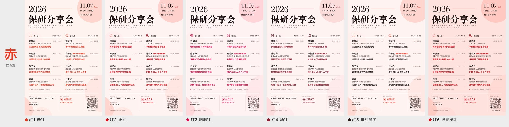
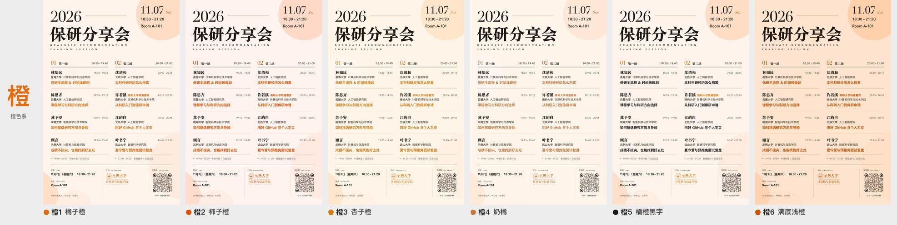
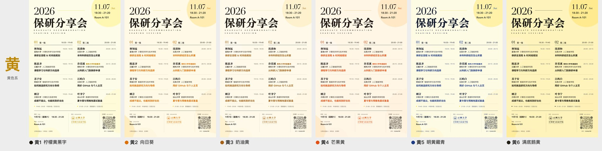
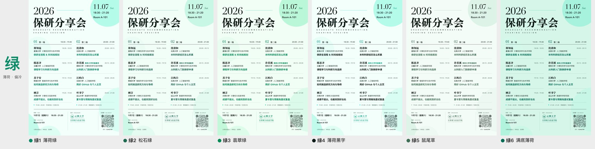
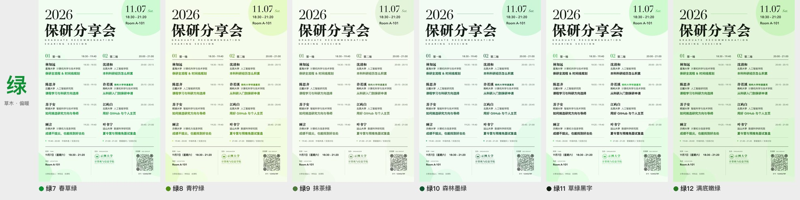
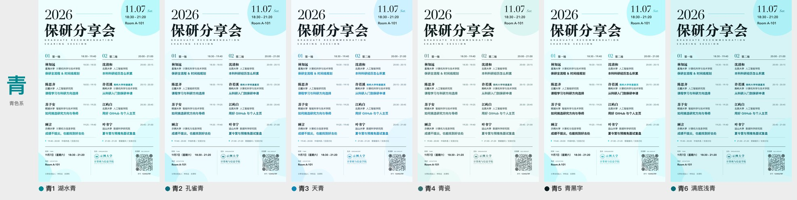
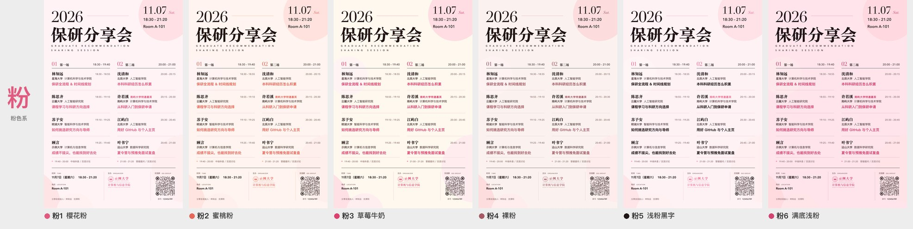

# 配色一览 · Palettes

54 款配色的全部色值（sRGB 十六进制）。所有颜色都在 OKLCH 色彩空间里定义，源码见 [`posterkit/palettes.py`](../posterkit/palettes.py)。

| 列 | 含义 |
|---|---|
| 墨色 ink | 主标题、姓名、底栏内容 |
| 正文 body | 院校、英文副标题、场次时间 |
| 注释 muted | 嘉宾时间、小标签、注释 |
| 强调 accent | 分享主题、场次编号、星期、特邀标签 |
| 点缀 pop | 年份横线、场次末尾圆点 |
| 细线 hair | 嘉宾之间的分隔线 |
| 背景 bg | 背景渐变的三个色标 |

## 赤 · 红色系

| 编号 | 名称 | id | 墨色 | 正文 | 注释 | 强调 | 点缀 | 细线 | 背景渐变 |
|---|---|---|---|---|---|---|---|---|---|
| 红1 | 朱红 | `red-1` | `#211512` | `#543F3C` | `#8F736E` | `#E63B25` | `#FE6E57` | `#F0C6BD` | `#FFF1EE` → `#FFFCFB` → `#FFECE9` |
| 红2 | 正红 | `red-2` | `#221413` | `#543F3D` | `#8F7270` | `#D40C1A` | `#F84C48` | `#F0C5C1` | `#FFF1EF` → `#FFFCFC` → `#FFECEB` |
| 红3 | 胭脂红 | `red-3` | `#211415` | `#543F40` | `#8E7274` | `#D60B4C` | `#F55A79` | `#F0C4C8` | `#FFF0F1` → `#FFFCFC` → `#FFECED` |
| 红4 | 酒红 | `red-4` | `#211415` | `#543F3F` | `#8F7273` | `#901C31` | `#D05A67` | `#E4C5C6` | `#FFF1F0` → `#FFFCFC` → `#FFECEC` |
| 红5 | 朱红黑字 | `red-5` | `#221413` | `#543F3C` | `#8F736E` | `#F13B2E` 同墨色（黑字款） | `#FB5A4A` | `#F0C5BE` | `#FFF1EF` → `#FFFCFB` → `#FFECE9` |
| 红6 | 满底浅红 | `red-6` | `#221413` | `#543F3D` | `#8F736F` | `#C90F1A` | `#F45249` | `#E8ADA6` | `#FFE0DB` → `#FEEEEC` → `#FDD8D3` |

## 橙 · 橙色系

| 编号 | 名称 | id | 墨色 | 正文 | 注释 | 强调 | 点缀 | 细线 | 背景渐变 |
|---|---|---|---|---|---|---|---|---|---|
| 橙1 | 橘子橙 | `orange-1` | `#20160F` | `#524136` | `#8C7566` | `#EA6A09` | `#FE973B` | `#ECC9B2` | `#FFF2E8` → `#FFFCFA` → `#FFEEE0` |
| 橙2 | 柿子橙 | `orange-2` | `#211510` | `#534038` | `#8E746A` | `#EA5202` | `#FD7F44` | `#EFC7B7` | `#FFF1EB` → `#FFFCFB` → `#FFEDE5` |
| 橙3 | 杏子橙 | `orange-3` | `#20160E` | `#514235` | `#8A7665` | `#DF7B0C` | `#FCAE52` | `#E8CBAF` | `#FFF2E4` → `#FFFCF9` → `#FFEEDB` |
| 橙4 | 奶橘 | `orange-4` | `#1F1610` | `#4F4239` | `#88766A` | `#CB7739` | `#EEAE7B` | `#E6CFBE` | `#FFF2E6` → `#FFFCFA` → `#FEEEDF` |
| 橙5 | 橘橙黑字 | `orange-5` | `#1E1712` | `#4E423A` | `#87776C` | `#F27700` 同墨色（黑字款） | `#FE9135` | `#ECC9B2` | `#FFF2E8` → `#FFFCFA` → `#FFEEE0` |
| 橙6 | 满底浅橙 | `orange-6` | `#21150F` | `#524136` | `#8C7567` | `#D15300` | `#F58028` | `#DFB490` | `#FFE2CA` → `#FEF0E4` → `#FDDBBE` |

## 黄 · 黄色系

| 编号 | 名称 | id | 墨色 | 正文 | 注释 | 强调 | 点缀 | 细线 | 背景渐变 |
|---|---|---|---|---|---|---|---|---|---|
| 黄1 | 柠檬黄黑字 | `yellow-1` | `#1B1811` | `#49453A` | `#7F7A6C` | `#BD8704` 同墨色（黑字款） | `#F0DA1C` | `#DAD5B8` | `#FDFCE4` → `#FFFFFA` → `#FBFADA` |
| 黄2 | 向日葵 | `yellow-2` | `#1D1711` | `#4C4339` | `#84786B` | `#E06E01` | `#FDC010` | `#E2D3B3` | `#FFF9E1` → `#FFFEF8` → `#FFF5D6` |
| 黄3 | 奶油黄 | `yellow-3` | `#1D1711` | `#4C4339` | `#84786B` | `#A56217` | `#EBC669` | `#E0D3B7` | `#FFF9E6` → `#FFFEFA` → `#FEF5DC` |
| 黄4 | 芒果黄 | `yellow-4` | `#1F1611` | `#504239` | `#88766A` | `#E84E10` | `#FCAA2B` | `#EACFB1` | `#FFF6E3` → `#FFFDF8` → `#FFF1D8` |
| 黄5 | 明黄藏青 | `yellow-5` | `#111A2D` | `#3D4556` | `#707A90` | `#1F3C86` | `#F0D116` | `#DDD5B4` | `#FFFBE0` → `#FFFFFA` → `#FDF8D2` |
| 黄6 | 满底鹅黄 | `yellow-6` | `#1B1811` | `#49453A` | `#7F7A6C` | `#231F14` | `#231F14` | `#D0BE79` | `#FFF3B5` → `#FFF9DC` → `#FFEFA3` |

## 绿 · 薄荷 · 偏冷

| 编号 | 名称 | id | 墨色 | 正文 | 注释 | 强调 | 点缀 | 细线 | 背景渐变 |
|---|---|---|---|---|---|---|---|---|---|
| 绿1 | 薄荷绿 | `mint-1` | `#0E1C17` | `#354A42` | `#668277` | `#0B8A68` | `#00EAB0` | `#B1DCCD` | `#EFFFF9` → `#FFFFFF` → `#EDFFF8` |
| 绿2 | 松石绿 | `mint-2` | `#0E1C16` | `#364A41` | `#678175` | `#1F6B52` | `#34C696` | `#B3DCC9` | `#EFFDF6` → `#FCFFFD` → `#EAFCF3` |
| 绿3 | 翡翠绿 | `mint-3` | `#101B14` | `#384A3F` | `#698172` | `#028B54` | `#16D584` | `#B7DBC4` | `#EEFEF3` → `#FCFFFD` → `#E9FDF0` |
| 绿4 | 薄荷黑字 | `mint-4` | `#0D1C18` | `#344A44` | `#648279` | `#0DAB89` 同墨色（黑字款） | `#0AE8BB` | `#B1DCCD` | `#EFFFF9` → `#FFFFFF` → `#EDFFF8` |
| 绿5 | 鼠尾草 | `mint-5` | `#0F1B15` | `#374A3F` | `#688173` | `#406F56` | `#81BA9B` | `#C1D7CA` | `#F3FCF6` → `#FCFFFD` → `#EFFAF3` |
| 绿6 | 满底薄荷 | `mint-6` | `#0E1C17` | `#354A42` | `#668277` | `#036E55` | `#23C79D` | `#90CDB7` | `#D4F6E9` → `#E9FAF4` → `#C9F3E3` |

## 绿 · 草木 · 偏暖

| 编号 | 名称 | id | 墨色 | 正文 | 注释 | 强调 | 点缀 | 细线 | 背景渐变 |
|---|---|---|---|---|---|---|---|---|---|
| 绿7 | 春草绿 | `grass-1` | `#121B12` | `#3B4A3C` | `#6D806E` | `#0F9035` | `#4AE062` | `#BDDABE` | `#F0FDF0` → `#FCFFFC` → `#ECFCEC` |
| 绿8 | 青柠绿 | `grass-2` | `#151A10` | `#3F4938` | `#727F69` | `#4F8D11` | `#AEE83D` | `#C8D8B5` | `#F5FDE8` → `#FDFFFA` → `#F2FBE3` |
| 绿9 | 抹茶绿 | `grass-3` | `#141B11` | `#3E4939` | `#71806A` | `#4E793E` | `#97C878` | `#CCD9C2` | `#F6FBF0` → `#FDFFFC` → `#F3FAEC` |
| 绿10 | 森林墨绿 | `grass-4` | `#101B14` | `#384A3E` | `#6A8171` | `#115531` | `#259F56` | `#BADBC1` | `#F1FDF3` → `#FCFFFC` → `#EDFBEF` |
| 绿11 | 草绿黑字 | `grass-5` | `#121B12` | `#3B4A3B` | `#6D806E` | `#2AAF3D` 同墨色（黑字款） | `#55DF5C` | `#BEDABD` | `#F1FDF0` → `#FCFFFC` → `#EDFCEC` |
| 绿12 | 满底嫩绿 | `grass-6` | `#131B11` | `#3D493A` | `#6F806C` | `#297623` | `#60C648` | `#AAC99C` | `#E1F5D8` → `#F0FAEB` → `#D9F2CE` |

## 青 · 青色系

| 编号 | 名称 | id | 墨色 | 正文 | 注释 | 强调 | 点缀 | 细线 | 背景渐变 |
|---|---|---|---|---|---|---|---|---|---|
| 青1 | 湖水青 | `cyan-1` | `#0B1B1C` | `#324A4B` | `#618183` | `#008890` | `#29D7D9` | `#ABDCDC` | `#EBFEFD` → `#FBFFFF` → `#E5FCFC` |
| 青2 | 孔雀青 | `cyan-2` | `#0C1B1E` | `#324A4E` | `#628087` | `#0A6C7C` | `#09B2C7` | `#ACDBE2` | `#EDFDFF` → `#FCFFFF` → `#E6FBFF` |
| 青3 | 天青 | `cyan-3` | `#0E1A21` | `#354852` | `#657F8C` | `#0F85B4` | `#3FC0F2` | `#AFD8EA` | `#F2FBFF` → `#FDFEFF` → `#ECF9FF` |
| 青4 | 青瓷 | `cyan-4` | `#0B1C1A` | `#324A48` | `#62817F` | `#38716F` | `#7BC0B9` | `#BCD8D4` | `#F1FCFA` → `#FCFFFE` → `#EDFAF8` |
| 青5 | 青黑字 | `cyan-5` | `#0B1B1D` | `#324A4D` | `#628184` | `#15A5B2` 同墨色（黑字款） | `#17D0D8` | `#ABDBDE` | `#EAFEFE` → `#FBFFFF` → `#E5FCFD` |
| 青6 | 满底浅青 | `cyan-6` | `#0B1B1E` | `#324A4D` | `#628185` | `#096A77` | `#17BAC8` | `#86CCCF` | `#D3F4F6` → `#E9FAFA` → `#C8F1F3` |

## 蓝 · 蓝色系

| 编号 | 名称 | id | 墨色 | 正文 | 注释 | 强调 | 点缀 | 细线 | 背景渐变 |
|---|---|---|---|---|---|---|---|---|---|
| 蓝1 | 钴蓝 | `blue-1` | `#121726` | `#3A4152` | `#7A8193` | `#2345B0` | `#628EED` | `#BFCBE2` | `#F5F9FF` → `#FFFFFF` → `#F4F8FF` |
| 蓝2 | 天蓝 | `blue-2` | `#111922` | `#394655` | `#6B7C8F` | `#167CD4` | `#55ABF7` | `#B7D5F0` | `#ECF6FF` → `#FBFDFF` → `#E6F3FF` |
| 蓝3 | 克莱因蓝 | `blue-3` | `#141823` | `#3D4556` | `#707A90` | `#141FE0` | `#4473FB` | `#C2D1F3` | `#F0F4FF` → `#FCFDFF` → `#EBF1FF` |
| 蓝4 | 雾霾蓝 | `blue-4` | `#111922` | `#394655` | `#6B7C90` | `#45668A` | `#81A9D2` | `#C3D3E4` | `#EFF5FC` → `#FBFDFF` → `#EAF2FB` |
| 蓝5 | 蓝黑字 | `blue-5` | `#121922` | `#3C4655` | `#6E7B90` | `#337AEF` 同墨色（黑字款） | `#4A91F8` | `#BDD3F2` | `#EEF5FF` → `#FBFDFF` → `#E9F2FF` |
| 蓝6 | 满底浅蓝 | `blue-6` | `#121922` | `#3C4655` | `#6E7B90` | `#0D50C3` | `#438AF1` | `#9FC1EB` | `#D9EAFF` → `#EBF3FE` → `#CFE4FE` |

## 紫 · 紫色系

| 编号 | 名称 | id | 墨色 | 正文 | 注释 | 强调 | 点缀 | 细线 | 背景渐变 |
|---|---|---|---|---|---|---|---|---|---|
| 紫1 | 薰衣草 | `purple-1` | `#191621` | `#464254` | `#7C768E` | `#8154D5` | `#A789F0` | `#D3CBEF` | `#F5F2FF` → `#FDFCFF` → `#F2EEFF` |
| 紫2 | 香芋紫 | `purple-2` | `#1D151F` | `#4C4050` | `#847488` | `#A84BC0` | `#D085E9` | `#DEC8E8` | `#FAF0FF` → `#FEFCFF` → `#F9ECFF` |
| 紫3 | 葡萄紫 | `purple-3` | `#181722` | `#454254` | `#7A778E` | `#5C25B9` | `#8C69ED` | `#D0CCF0` | `#F4F3FF` → `#FDFCFF` → `#F0EFFF` |
| 紫4 | 藕荷 | `purple-4` | `#1D151E` | `#4D404E` | `#857387` | `#7A537D` | `#C097C6` | `#DBCBDD` | `#F8F2F9` → `#FEFCFE` → `#F6EEF7` |
| 紫5 | 紫黑字 | `purple-5` | `#1A1621` | `#474253` | `#7D768D` | `#9964E5` 同墨色（黑字款） | `#A97CF0` | `#D6CAEE` | `#F6F2FF` → `#FDFCFF` → `#F3EEFF` |
| 紫6 | 满底浅紫 | `purple-6` | `#1A1621` | `#474253` | `#7D768D` | `#6F34BD` | `#A376E9` | `#C4B4E5` | `#EBE3FC` → `#F4F0FD` → `#E6DCFA` |

## 粉 · 粉色系

| 编号 | 名称 | id | 墨色 | 正文 | 注释 | 强调 | 点缀 | 细线 | 背景渐变 |
|---|---|---|---|---|---|---|---|---|---|
| 粉1 | 樱花粉 | `pink-1` | `#211416` | `#543F41` | `#8E7275` | `#E05A7F` | `#FC99AC` | `#F0C4CA` | `#FFF1F4` → `#FFFCFD` → `#FFEEF2` |
| 粉2 | 蜜桃粉 | `pink-2` | `#211511` | `#544039` | `#8E746A` | `#E7685B` | `#FEA892` | `#F0C5BF` | `#FFF2EC` → `#FFFCFA` → `#FFEEE7` |
| 粉3 | 草莓牛奶 | `pink-3` | `#221413` | `#543F3D` | `#8F7270` | `#DB426D` | `#F87F9C` | `#EFC4CC` | `#FFF7EC` → `#FFFEFB` → `#FFF3E4` |
| 粉4 | 裸粉 | `pink-4` | `#211512` | `#543F3C` | `#8F736E` | `#A65A65` | `#DC999E` | `#E1C6C6` | `#FBF0ED` → `#FFFBF9` → `#F8EBE7` |
| 粉5 | 浅粉黑字 | `pink-5` | `#211416` | `#543F41` | `#8E7275` | `#EE6E91` 同墨色（黑字款） | `#FC93AC` | `#EFC4CC` | `#FFF0F4` → `#FFFBFC` → `#FFECF1` |
| 粉6 | 满底浅粉 | `pink-6` | `#211416` | `#543F41` | `#8E7275` | `#D34570` | `#F3829D` | `#E6ACB5` | `#FFE2E9` → `#FFF1F4` → `#FFDBE4` |
